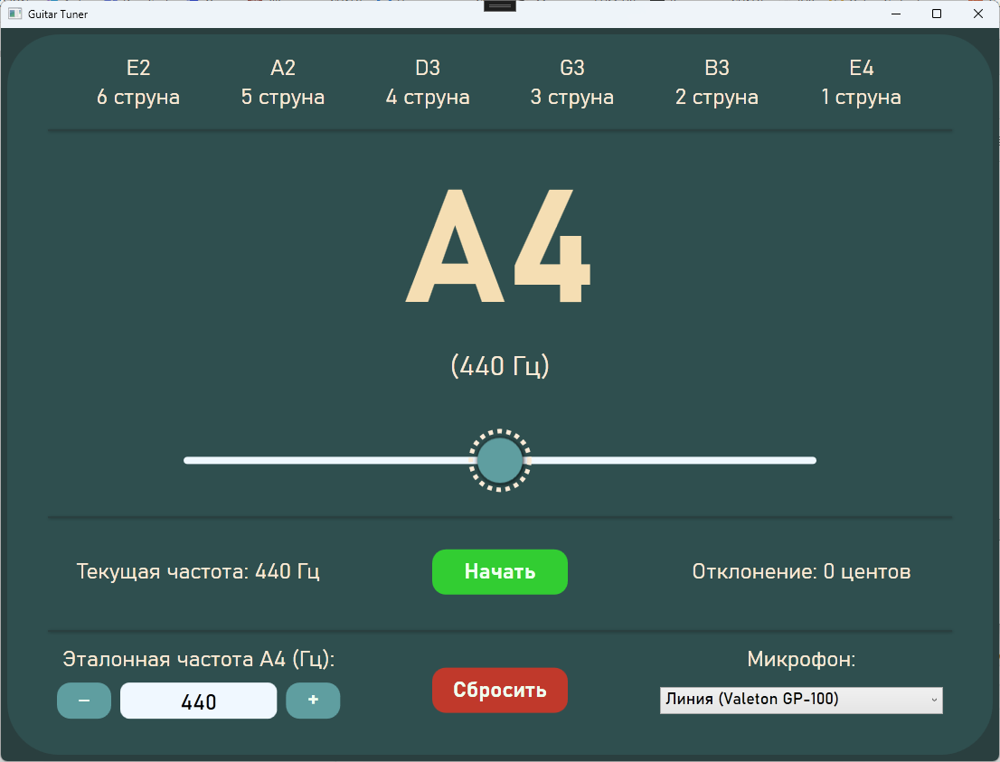

## 🎸 Guitar Tuner (Гитарный тюнер)

Приложение для настройки гитары на базе WPF (C#) и библиотеки NAudio. 

Определяет частоту звука с микрофона в реальном времени, вычисляет ближайшую ноту и показывает отклонение в центах.

## ✨ Основные возможности

-  Захват звука с выбранного микрофона (NAudio).
-  Определение частоты с помощью алгоритма автокорреляции с параболической интерполяцией.
-  Отображение текущей ноты, эталонной частоты и отклонения (в центах).
-  Визуальный индикатор (шарик), плавно показывающий отклонение от строя.
-  Настройка эталонной частоты A4 (диапазон 420–460 Гц).
-  Выбор активного микрофона из списка доступных устройств.

## 🛠️ Технологии

-  **Язык:** C# (.NET 8)
-  **UI:** WPF (Windows Presentation Foundation), XAML
-  **Звук:** NAudio (захват сигнала)
-  **Архитектура:** Разделение логики (`Logic/PitchDetector`, `Logic/NoteAnalyzer`) и UI (`MainWindow`).

## 🧠 Как это работает

1. **Захват звука:** NAudio оцифровывает сигнал с микрофона (44100 Гц, 16 бит).
2. **Определение частоты:** Алгоритм автокорреляции ищет период колебания, интерполяция уточняет результат до долей герца.
3. **Музыкальный анализ:** Частота переводится в полутоны относительно A4 (440 Гц). Вычисляется ближайшая нота и отклонение в центах (1 полутон = 100 центов).
4. **Визуализация:** Специальный таймер (60 FPS) плавно сдвигает шарик к рассчитанной позиции.
